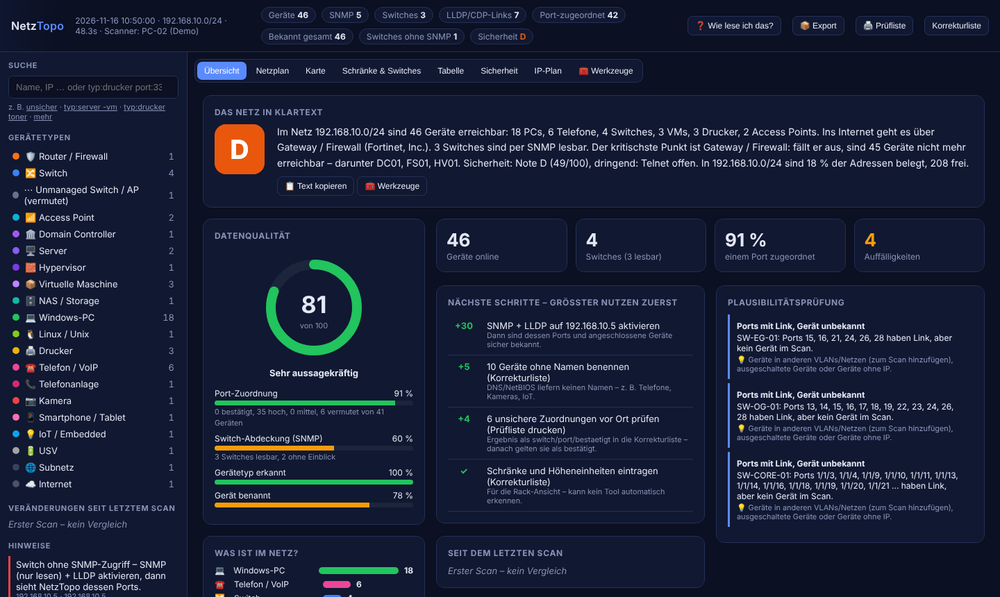
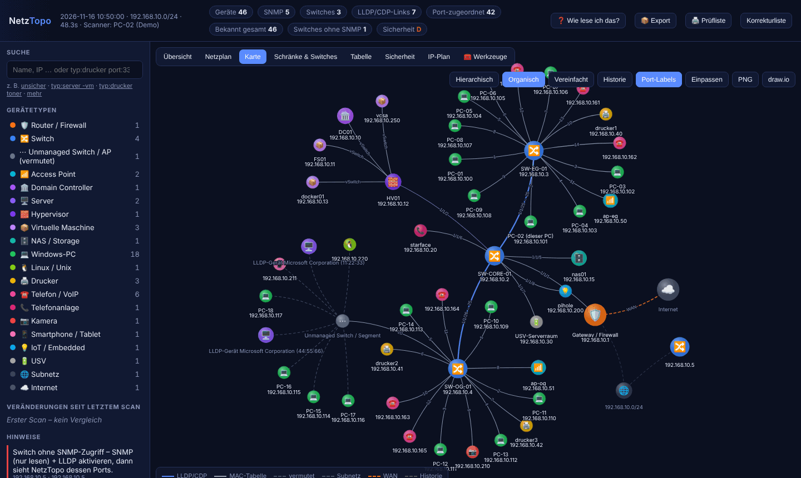
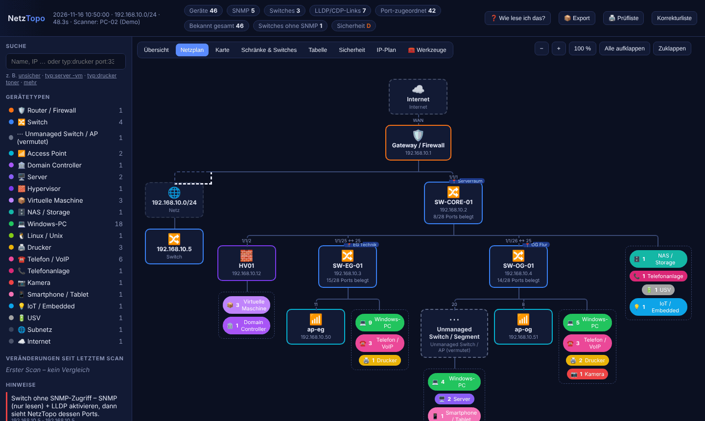
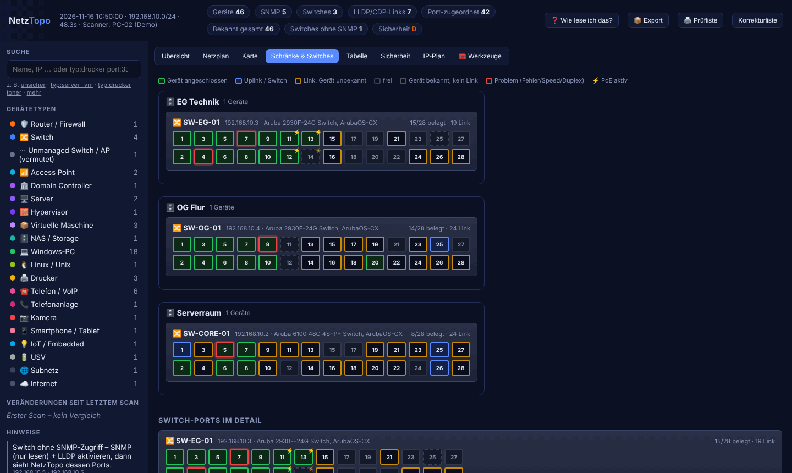
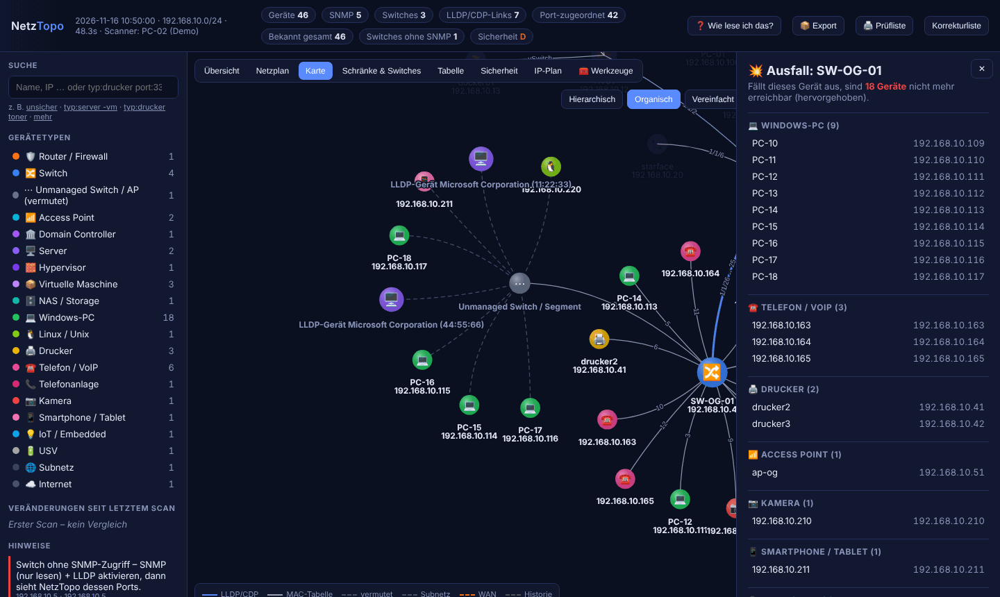
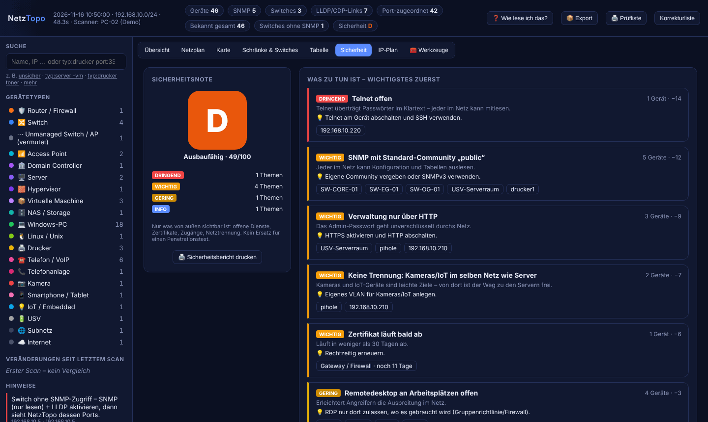
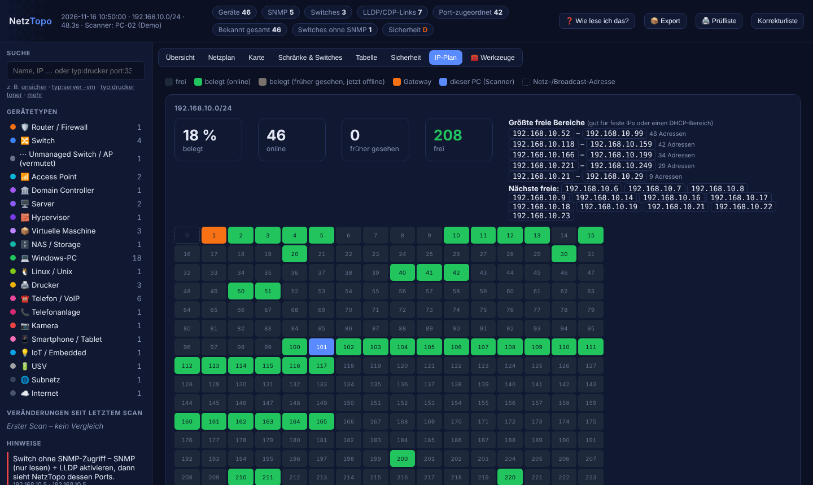

<div align="center">

# 🔀 NetzTopo

**Netzwerk-Scanner und Topologie-Dokumentation für kleine und mittlere Netze.**

Findet alle Geräte, zeigt, **welches Gerät an welchem Switch-Port hängt**, und erzeugt daraus Netzplan, Schrank-Ansicht, Sicherheitsnote und eine Excel-Dokumentation.

Kostenlos · ohne Installation · ohne Cloud · ohne Admin-Rechte

[](https://github.com/KnoxxiY/NetzTopo/archive/refs/heads/main.zip)




</div>

---

## 🚀 Schnellstart

1. **[NetzTopo herunterladen](https://github.com/KnoxxiY/NetzTopo/archive/refs/heads/main.zip)**. Alternativ oben auf den grünen Button **Code → Download ZIP** klicken.
2. Die ZIP mit Rechtsklick → **Alle extrahieren** entpacken.
3. Den passenden Ordner öffnen:

| Ordner | Für | Start |
|---|---|---|
| **`Windows`** | den PC (Windows 7 bis 11, 32/64 Bit) | `NetzTopo starten.bat` |
| **`Portable`** | den USB-Stick, zusätzlich mit Linux | Windows: `NetzTopo starten.bat` · Linux: `sh netztopo.sh` |

4. Netz eintragen, zum Beispiel `192.168.1.0/24`, und die SNMP-Community der Switches angeben. Dann auf **Scan starten** klicken.

Python muss nicht installiert sein, es ist dabei. Der Ordner lässt sich überallhin kopieren, auch auf einen USB-Stick.

---

## 📸 Ansichten

| | |
|---|---|
| **Karte** – alle Geräte und Verbindungen<br> | **Netzplan** – Internet → Firewall → Switches → Geräte<br> |
| **Schränke & Switches** – Port-Belegung, PoE, Kabelfehler<br> | **💥 Ausfall-Simulator** – was fällt mit aus?<br> |
| **🛡️ Sicherheit** – Note A–E mit Lösungen<br> | **IP-Plan** – jede Adresse auf einen Blick<br> |

---

## ✨ Funktionen

**Erkennen**
- Ping, ARP, Port-Scan, NetBIOS, DNS, UPnP/SSDP, HTTP-Titel und TLS-Zertifikate
- **SNMP + LLDP/CDP + MAC-Tabellen**: ordnet jedes Gerät seinem Switch-Port zu, mit Zuverlässigkeit *hoch / mittel / vermutet / bestätigt*
- Erkennt Mini-Switches ohne SNMP, VMs auf Hypervisoren, PoE, Seriennummern, Tonerstände, CRC-Fehler und Halbduplex

**Verstehen**
- **💥 Ausfall-Simulator:** Rangliste der kritischsten Punkte (Single Points of Failure)
- **🛡️ Sicherheits-Check:** Telnet, FTP, HTTP-Verwaltung, Standard-SNMP, ablaufende Zertifikate, alte SSH-Versionen, Kameras/IoT ohne Netztrennung
- **Engpass-Finder:** 100-Mbit-Uplinks, zu langsam angebundene Server
- **Das Netz in Klartext:** eine automatische Zusammenfassung
- **Datenqualität 0–100** mit den nächsten sinnvollen Schritten

**Arbeiten**
- 🖨️ **Notfallblatt** für den Serverschrank, mit Hochfahr-Reihenfolge nach Stromausfall
- 🏷️ **Kabel-Etiketten**, ✅ **Prüfliste** für die Begehung, **Sicherheitsbericht** zum Abhaken
- 🔴 **Live-Überwachung** und ⚡ **Wake-on-LAN** (in der Browser-Oberfläche)
- 🔎 **Profi-Suche:** `typ:drucker toner`, `port:3389 typ:pc`, `ip:10.0.0.0/25`, `unsicher`, `-vm` …
- **Geräteverlauf:** neu, offline, zuletzt gesehen; geplante Scans mit **Alarm** per Teams oder ntfy

---

## 📦 Export – für jede Software

Nach jedem Scan landen im Ordner `export` diese Dateien:

| Datei | Für |
|---|---|
| `netztopo.xlsx` | Excel, mit 7 Blättern: Geräte, Switch-Ports, Verbindungen, Hinweise, Sicherheit, Ausfallrisiko, IP-Plan |
| `*.csv` | Excel (Semikolon) oder international (Komma, RFC 4180), zum Beispiel für GLPI, Snipe-IT, i-doit, Lansweeper, NetBox |
| `netztopo.json` | eigene Skripte und APIs |
| `topologie.graphml` | yEd, Gephi, Cytoscape |
| draw.io / PNG | Wikis, Präsentationen |

---

## 🎯 Genauigkeit

- Aktiviere **SNMP (nur lesen) und LLDP** auf den managed Switches. Ohne diese Daten kann kein Tool wissen, was an welchem Port hängt.
- Unmanaged Mini-Switches sind für jeden Scanner unsichtbar. Mit diesen Schritten wird der Plan trotzdem nahezu fehlerfrei:
  1. **Prüfliste** drucken.
  2. Vor Ort abhaken.
  3. Die Ergebnisse in `korrekturen.csv` eintragen.
  4. `--rebuild` ausführen.
- In der Korrekturliste pflegst du auch Namen, Typen, Schränke und Höheneinheiten. Daraus entsteht die Rack-Ansicht.

---

## ⌨️ Kommandozeile

```
netztopo --cli 192.168.1.0/24 --community public   Scan ohne Oberfläche
netztopo --auto                                     mit gespeicherten Einstellungen (geplante Aufgabe)
netztopo --rebuild                                  Bericht aus letztem Scan neu erzeugen
netztopo --web                                      Browser-Oberfläche
netztopo --demo                                     Beispielbericht ohne Scan
```

Unter Windows ersetzt du `netztopo` durch `"NetzTopo starten.bat"`, mit vorhandenem Python ab 3.8 durch `python netztopo.py`.

---

## 🔒 Sicherheit und Datenschutz

- Der Scan ist **nur lesend**: Ping, Verbindungsaufbau, SNMP-GET. An Geräten wird nichts verändert.
- Alles bleibt lokal. Es geht nichts in eine Cloud. Der optionale Webhook wird unter Windows verschlüsselt gespeichert (DPAPI).
- Für Support-Anfragen gibt es einen **anonymen Export**, in dem Namen und Adressen ersetzt sind.
- ⚠️ Scanne nur Netze, für die du zuständig bist. Virenscanner können Netzwerk-Scanner melden.

**Läuft auf:**
- Windows 11, 10 und 8.1 (32 und 64 Bit)
- Windows 7 SP1 (mit Update KB2999226)
- Linux x86_64
- macOS und Raspberry Pi, wenn `python3` vorhanden ist

---

## 🛠️ Entwicklung

```
Das komplette Programm steckt in einer Datei: Windows/app/netztopo.py (lesbar, läuft ab Python 3.8 auch direkt mit: python netztopo.py)
```

Änderungen stehen in [`CHANGELOG.md`](CHANGELOG.md). Lizenz: [MIT](LICENSE). Komponenten von Drittanbietern: [`THIRD-PARTY-NOTICES.md`](THIRD-PARTY-NOTICES.md).
